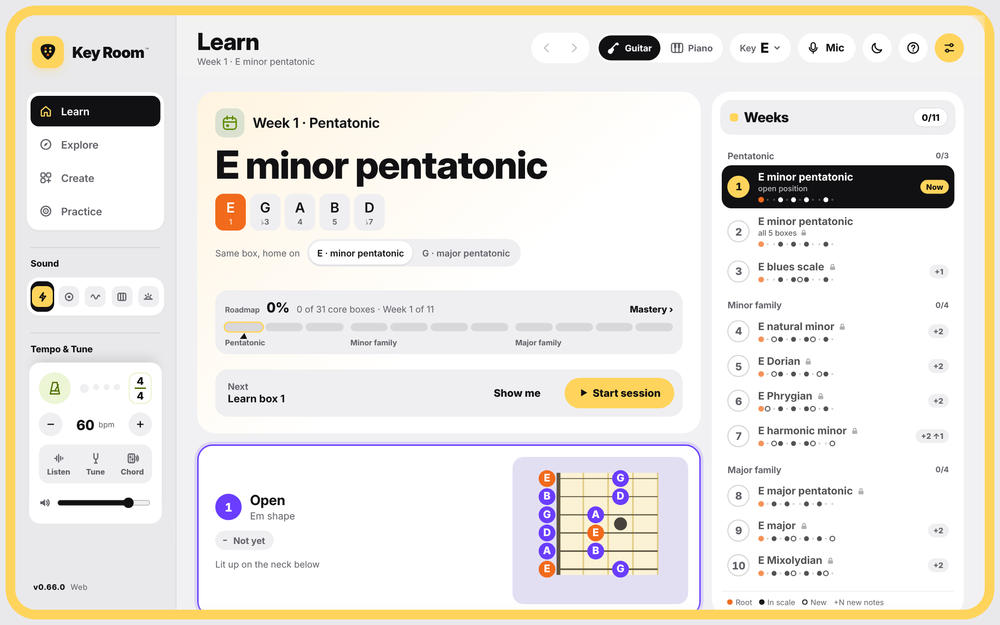

<h1 align="center">Key Room™ — Beta</h1>

<b>Learn guitar one scale per week, built up from minor pentatonic.</b> 
Free beta for Windows, iPhone and Android · runs offline · beta ends January 31, 2027

<a href="#get-it"><b>⬇ Get Key Room</b></a> &nbsp;·&nbsp; <a href="../../issues/new?template=feedback.yml">💬 Send feedback</a> &nbsp;·&nbsp; <a href="../../issues/new?template=bug.yml">🐞 Report a bug</a>

## What it is

Key Room is a focused guitar practice app. Instead of handing you every scale at once, it teaches **one scale per week**, in E, starting from the open position — and every new scale is shown as a change from **minor pentatonic**, the shape you already know.

- **Learn** — this week's scale, its boxes, mic checks that unlock the next week, and your roadmap
- **Explore** — every scale's 5 shapes (or 7 three-per-string patterns) with arpeggios, any key, and how chords are built
- **Create** — tap or strum chords, lock them into a progression, get the chords that fit next, jam over it, export MIDI
- **Practice** — a guided Daily 10 and ear training
- Seven themes, recorded guitar sounds, metronome, tuner and chord identifier

## Get it

Two versions, same app, same features, updated together.

### Windows (64-bit)

1. Open **[Releases](../../releases/latest)** and download **one** file:
   - `KeyRoom-Setup-0.44.0.exe` — installs with Start menu and desktop shortcuts *(recommended)*
   - `KeyRoom-Portable-0.44.0.exe` — runs without installing
2. Run it. Windows will probably show **"Windows protected your PC"** because this beta isn't code-signed yet. Click **More info → Run anyway**.
3. Read and accept the beta license on first launch.

Requirements: Windows 10 or 11, 64-bit. Each release lists SHA-256 checksums and a VirusTotal scan link.

### iPhone & Android

**[Open Key Room on your phone → zjuv007.github.io/keyroom-beta/app](https://zjuv007.github.io/keyroom-beta/app/)**

- **iPhone:** open the link in **Safari** → tap **Share** → **Add to Home Screen** → **Add**.
- **Android:** open the link in **Chrome** → tap **⋮** → **Install app** (or **Add to Home screen**).

It opens full-screen from its own icon, works offline, and updates itself the next time you open it. Accept the beta license on first launch.

## What I'd love feedback on

1. Is **one scale per week** the right pace?
2. What's confusing in the **first 5 minutes**?
3. Would you pay a few dollars for a finished version?

👉 **[Send feedback](../../issues/new?template=feedback.yml)** (about 3 minutes, needs a GitHub account) — or tap **Beta · Feedback → Copy feedback** in the app and paste it in the Reddit thread or a DM. No account needed.

## Privacy

Key Room runs **100% offline**. No account, no cloud analytics. The Windows app blocks all internet requests; the phone version only downloads itself (and its updates) from this page. Your progress is saved only on your device. The microphone is used only when you turn on the tuner or note listener, and never leaves your device.

**Usage report (stays on your device):** to help improve the beta, Key Room keeps a simple summary on your device — which screens and buttons you use, roughly how long, your progress, and any errors. It is **never sent automatically**. Open **Beta · Feedback → View my usage report** to read it, pause it, clear it, or choose to attach it to your feedback.

## Beta terms (short version)

- ✅ Free for your personal practice until **January 31, 2027** — after that the beta stops opening; grab the newest version to keep going (your progress carries over).
- 🚫 Please don't re-upload, redistribute, modify, or resell it — **share this page's link instead.**
- The full terms are in **[LICENSE.txt](LICENSE.txt)** and are shown in the app.

This repository holds the downloads and feedback. The phone version is served from `docs/app` so it can be installed; it is © Zach Juveli like the rest — please don't copy, re-host or reuse it.

---

© 2026 Zach Juveli. All rights reserved. Key Room™ is a trademark of Zach Juveli. Its interface, code, graphics and lesson content are protected by copyright.
Plus Jakarta Sans font © its authors, used under the SIL Open Font License 1.1.
Sounds: Salamander Grand Piano V3 by Alexander Holm (CC BY 3.0); electric guitar, acoustic guitar and bass from tonejs-instruments by Nicholaus Brosowsky (CC BY 3.0).
